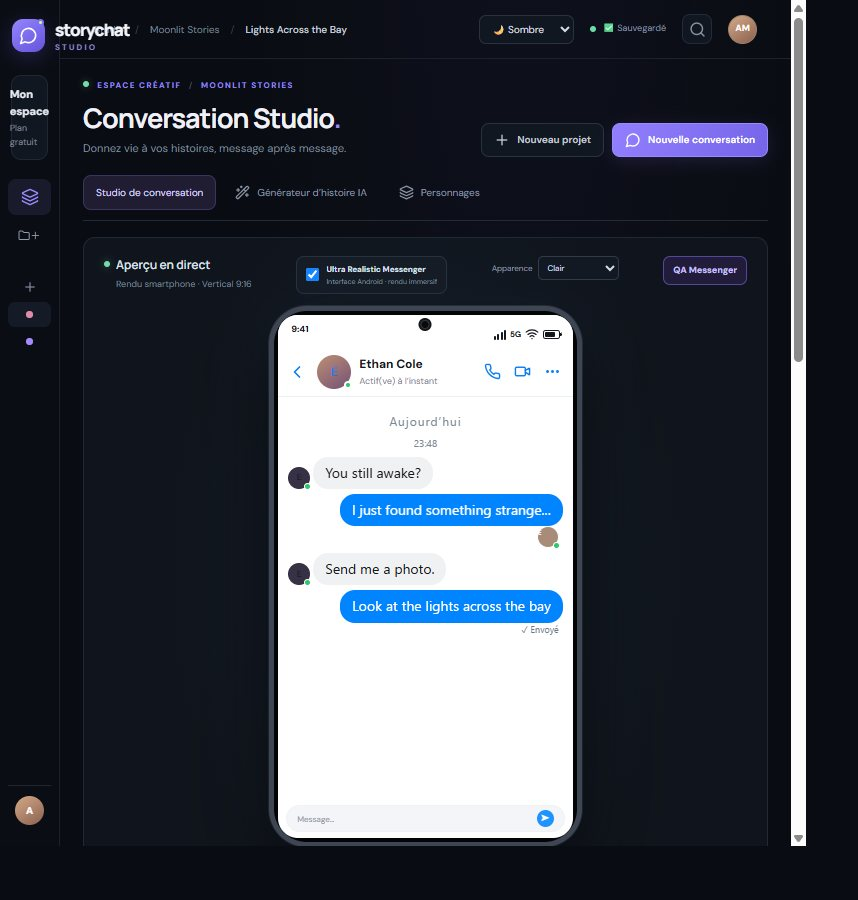
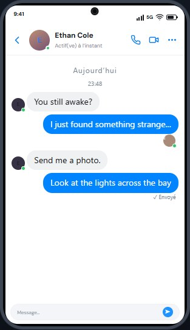
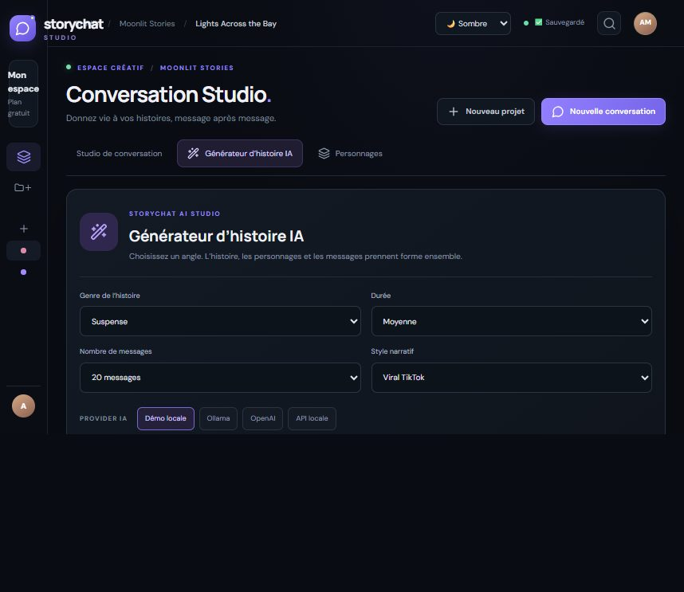
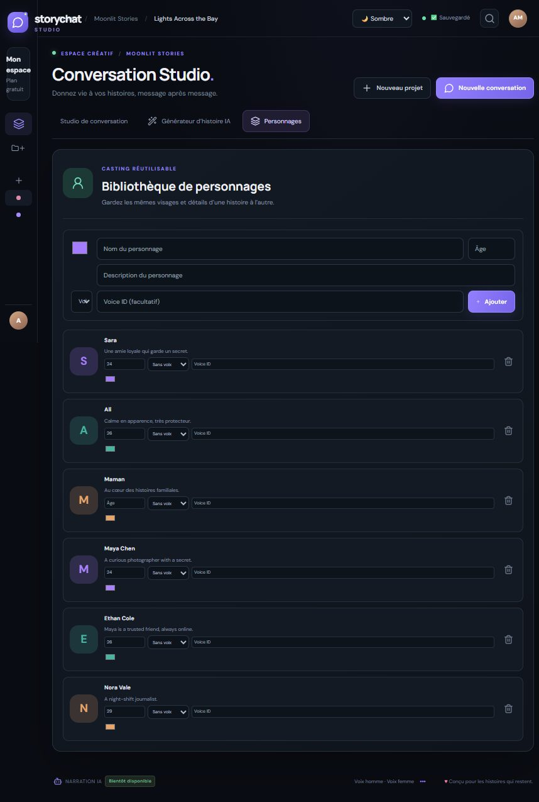
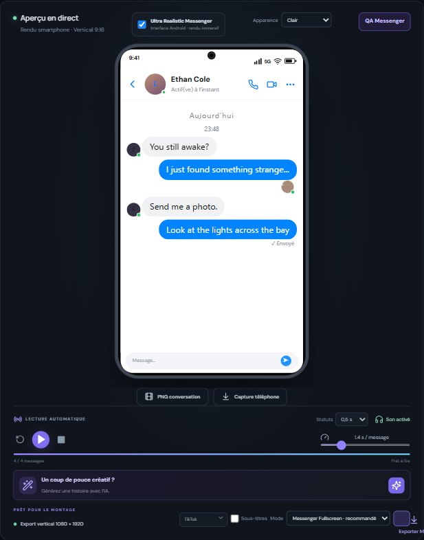

<div align="center">

# StoryChat Studio

**Write the conversation. Build the moment. Share it as a vertical story.**

Create fictional, Messenger-style conversations and turn them into polished videos for TikTok, YouTube Shorts, Instagram Reels, and Facebook Reels.

[](LICENSE)
[](https://react.dev/)
[](https://nodejs.org/)
[](https://www.remotion.dev/)

</div>

## Overview

StoryChat Studio is a modern Messenger-style storytelling platform designed to create realistic chat conversations and export them as vertical videos for TikTok, YouTube Shorts, Instagram Reels, and Facebook Reels.

Write and arrange a conversation in the timeline, preview it inside a phone interface, manage recurring characters, and render a 1080 × 1920 MP4. StoryChat Studio is intended for fictional stories and creative projects.

## Screenshots

| Dashboard | Messenger preview |
|---|---|
|  |  |

| Story generator | Character library |
|---|---|
|  |  |

| Video export |
|---|
|  |

## Features

- **Messenger-style conversation editor** with a live phone preview.
- **Timeline editing** for messages, typing events, calls, reactions, and other chat events.
- **Character management** with reusable participant profiles and avatars.
- **Story generation** in French, English, Italian, Brazilian Portuguese, Tunisian/Algerian/Moroccan Darija, or Egyptian Arabic through the demo provider, OpenAI, Ollama, or a compatible local endpoint.
- **Automatic and manual save** with visible save status and keyboard shortcut support.
- **Message status and reactions**, including sent, delivered, seen, and typing indicators.
- **Light and dark Messenger appearance** for the preview and video export.
- **PNG capture** for the conversation or the full phone screen.
- **MP4 export** rendered with Remotion and FFmpeg at 1080 × 1920 and 30 fps.
- **Persistent storage** through MySQL, with a JSON-backed local fallback.

## Getting started

### Requirements

- Node.js 20 or newer and npm.
- MySQL 8 or newer for relational persistence. The local JSON store can be used without MySQL.
- A Chromium-compatible environment for Remotion video rendering. Remotion manages its browser and media tooling as needed.

### Install dependencies

From the project root:

```bash
npm install
```

### Configure the backend

Create a local backend environment file:

```bash
cp backend/.env.example backend/.env
```

On Windows PowerShell, use:

```powershell
Copy-Item backend/.env.example backend/.env
```

Edit `backend/.env` and set the database connection details:

```dotenv
PORT=4000
FRONTEND_ORIGIN=http://localhost:5173
DB_HOST=127.0.0.1
DB_PORT=3306
DB_USER=root
DB_PASSWORD=your-local-password
DB_NAME=storychat_studio
DB_CREATE_DATABASE=true
```

`DB_CREATE_DATABASE=true` asks the configured MySQL account to create the database if it does not exist. Set it to `false` when the database has already been provisioned and the account should not create schemas. Never commit `.env` files or real credentials.

If `DB_HOST` or `DB_NAME` is not configured, the API uses its persistent JSON fallback at `backend/.data/store-memory.json`. This runtime data is local and ignored by Git.

### Run the application

```bash
npm run dev
```

The development command starts both the Express API and the Vite frontend. Open [http://localhost:5173](http://localhost:5173). By default, the API listens on [http://localhost:4000](http://localhost:4000).

Create a production frontend build with:

```bash
npm run build
```

## Configuration

Backend settings are read from `backend/.env`. Common options include:

| Variable | Purpose |
|---|---|
| `PORT` | Express API port (default: `4000`). |
| `FRONTEND_ORIGIN` | Allowed development frontend origin (default: `http://localhost:5173`). |
| `DB_HOST`, `DB_PORT`, `DB_USER`, `DB_PASSWORD`, `DB_NAME` | MySQL connection settings. |
| `DB_CREATE_DATABASE` | Allow startup to create `DB_NAME` when missing. |
| `OPENAI_API_KEY`, `OPENAI_MODEL` | Optional OpenAI story-generation provider. |
| `OLLAMA_URL`, `OLLAMA_MODEL` | Optional Ollama story-generation provider. |
| `LOCAL_AI_URL`, `LOCAL_AI_TOKEN` | Optional compatible local story-generation endpoint. |
| `REMOTION_CONCURRENCY` | Optional Remotion render concurrency setting. |

The demo story provider is available without an AI service. Configure provider credentials only in your local, untracked `.env` file.

The story generator supports French, English, Italian, Brazilian Portuguese, Tunisian/Algerian/Moroccan Darija, and Egyptian Arabic. The selected language is stored with each conversation and passed to configured AI providers.

## Architecture

```text
frontend/       React application, editor, live preview, and Remotion composition
backend/        Express API, persistence adapter, generation services, and export jobs
database/       MySQL schema
exports/        Generated MP4 files (local runtime output; not tracked)
uploads/        Uploaded avatars and message media (local runtime data; not tracked)
```

### Technology stack

- **Frontend:** React 18, Vite, Tailwind CSS, Framer Motion, Axios.
- **Backend:** Node.js, Express, MySQL (`mysql2`), and a persistent JSON fallback.
- **Video:** Remotion, Chromium, and FFmpeg.

## Roadmap

- Expand voice and narration options, including AI-assisted voice workflows.
- Continue refining WhatsApp, Instagram DM, and Telegram theme parity.
- Add and refine export presets and quality/performance options.
- Improve accessibility, documentation, and creative workflows.

Roadmap items are goals, not release commitments. Feature requests and focused contributions are welcome.

## Contributing

Contributions are welcome. Before opening a pull request:

1. Check existing issues and discussions for related work.
2. Keep changes focused and explain user-visible behavior changes.
3. Do not include generated exports, uploaded media, local databases, secrets, or environment files.
4. Run `npm run build` and any relevant checks.
5. Include concise reproduction steps or screenshots for user-interface changes.

See [CONTRIBUTING.md](CONTRIBUTING.md) for the full contribution guide.

## License

StoryChat Studio is released under the [MIT License](LICENSE).
